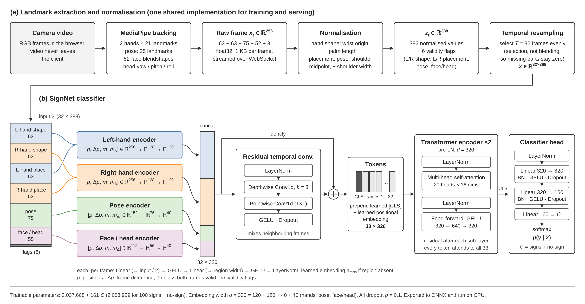
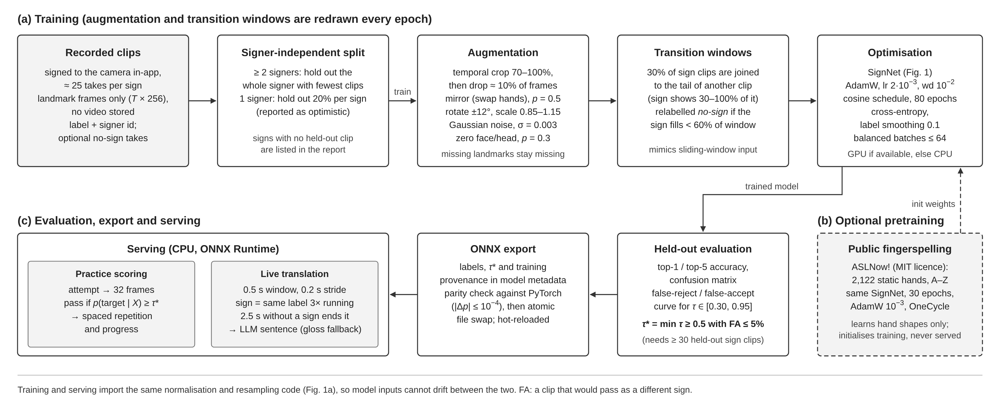

# aSigner

Learn Singapore Sign Language (SgSL) by signing to your camera and getting live feedback. A student portfolio project, not a substitute for learning from Deaf instructors.

## Status

Built so far:

- FastAPI server: Google sign-in, session cookie, lessons API, translation history API, delete-my-data, authenticated WebSocket.
- Database schema and migrations (users, signs, lessons, attempts, progress, translations).
- Next.js app: home page with lessons, camera check page with hand, body and face tracking.
- Landmark frame format (256 floats per frame) and the shared normaliser.
- Practice scoring over a WebSocket, spaced repetition and a progress API, waiting on the model.
- Lesson, practice, quiz and progress screens.
- Translator: live sign segmentation over a WebSocket, local Ollama sentence layer with a plain-gloss fallback, and a history page with delete and speech. Waiting on the model.
- Video translator (`/translate/video`): translate a recorded video instead of the live camera, with every model window's top guesses shown and downloadable as JSON. A debugging aid for the model. The video is tracked in the browser; only landmarks and their video times are sent, and sentences are only saved when asked.

Not there yet: a trained sign recognition model. Until clips are recorded and a model is trained, practice cannot score real attempts and the translator cannot recognise signs.

## How it works

```
Browser: camera -> MediaPipe hands + pose + face -> 1 KB landmark frame
   | WebSocket                      | REST via Next.js proxy (/api)
FastAPI: normalise -> sign model -> scoring / captions -> Postgres
```



Video never leaves the browser. Only landmark coordinates are sent. Progress and past translations are stored as text. Training clips recorded on `/record` are stored as landmark coordinates (no video) until you delete them or your account.

## Run locally

Server (uses a local SQLite file unless `DATABASE_URL` is set):

```bash
cd server
python -m venv .venv
.venv/Scripts/python -m pip install -r requirements.txt
.venv/Scripts/python -m alembic upgrade head
.venv/Scripts/python -m app.seed
.venv/Scripts/python -m uvicorn app.main:app --port 8000
```

Web:

```bash
cd web
npm install
npm run dev
```

Open http://localhost:3000.

### Google sign-in

1. In Google Cloud Console, create an OAuth client of type "Web application".
2. Add the redirect URI `http://localhost:3000/api/auth/callback`.
3. Copy `.env.example` to `.env` and fill in `GOOGLE_CLIENT_ID`, `GOOGLE_CLIENT_SECRET` and a long random `SESSION_SECRET`.

### Docker

`docker compose up --build` starts Postgres, Ollama, the server and the web app. The `ollama` service has not been run yet.

## Training the sign model

1. Add `DEV_LOGIN=true` to `.env` to sign in locally without Google (ignored unless `FRONTEND_URL` is localhost), or set up Google sign-in.
2. Open `/record` and record takes for each sign. Aim for 25 per sign, and vary distance, position and hand angle. Clips are saved under `server/data/clips/`.
3. Train and export:

```bash
cd ml
python -m venv .venv
.venv/Scripts/python -m pip install -r requirements.txt --extra-index-url https://download.pytorch.org/whl/cpu
.venv/Scripts/python train.py
```

Training (`train.py` and `pretrain.py`) uses a GPU whenever PyTorch can see one, and the CPU otherwise; it prints which at the start. In order: CUDA (NVIDIA, or AMD on a [ROCm build](https://pytorch.org/get-started/locally/), which PyTorch also reports as `cuda`), XPU (Intel Arc and Core Ultra graphics, on an [XPU build](https://pytorch.org/docs/stable/notes/get_start_xpu.html)), then MPS (Apple Silicon). Each needs the matching PyTorch build; the default one sees only the CPU (and MPS on a Mac). Integrated GPUs other than Intel Core Ultra's are mostly not supported by these builds. For an NVIDIA GPU, install a CUDA build of PyTorch instead (leave out `--extra-index-url ...cpu`, or follow [pytorch.org](https://pytorch.org/get-started/locally/)); `python -c "import torch; print(torch.cuda.is_available())"` should print `True`. On an Apple Silicon Mac the standard macOS build already includes MPS (`torch.backends.mps.is_available()` should print `True`); if an operation is missing there, set `PYTORCH_ENABLE_MPS_FALLBACK=1` to run it on the CPU. For a model this small a GPU may not be much faster, since augmentation runs on the CPU either way. The exported model always runs on the CPU, as the server does: GPU inference was tried and was slower for this model.



This writes `server/models/signs.onnx` (one file, with the labels and pass score inside it), which the server loads without a restart, plus accuracy and a confusion matrix under `ml/runs/`. With clips from one person only, the reported accuracy is optimistic; record a second person to get an honest number.

The model takes 32 frames of 388 features: the original 382 normalised values plus six validity flags for left/right hand shape, left/right hand placement, pose and face/head. These flags are inferred from existing recordings; the browser's 256-value frame format is unchanged. Face presence is inferred from nonzero face/head values, so a completely neutral face cannot be distinguished from missing face tracking.

Separate left-hand, right-hand, pose and face/head encoders turn positions, frame differences and validity flags into 120, 120, 40 and 40 dimensions. Hands carry most of a sign, so they get the most room. Each encoder has two layers, applied to each frame on its own: the first halves the input size, the second brings it to the region's width (`Linear → GELU → Linear → GELU → LayerNorm`). Hands go 256 → 128 → 120, pose 152 → 76 → 40 and face/head 112 → 56 → 40. Differences are zero for the first frame and whenever either adjacent observation is invalid, preventing tracking loss/recovery from appearing as motion. They describe motion over resampled clip time, not physical velocity. Entirely missing regions use learned embeddings. The four outputs are concatenated into 320 dimensions and processed by a residual temporal convolution (depthwise kernel 3, then a pointwise projection).

The model then prepends a learned classification token and adds learned positional embeddings. Two Transformer encoder layers, each with 20 attention heads (16 dimensions per head), let every token attend to the entire clip. The classification token's output passes through layer normalisation and a three-layer classifier (`320 → 320 → 160 → labels`, including the no-sign class). Each hidden classifier layer uses batch normalisation, GELU and dropout. All dropout probabilities are 0.1. Training requires at least two clips after the signer split; inference accepts a single clip using the saved batch-normalisation statistics.

There are `2,037,668 + 161 × C` trainable parameters, where `C` includes the no-sign class (2,053,929 for 100 signs plus no-sign). Existing recordings remain usable, but models exported for the previous 382-feature input must be retrained and re-exported; the server rejects them at load time. Checkpoints from `pretrain.py` made before the region encoders had two layers and uneven widths no longer fit; run `pretrain.py` again.

Vector versions of both figures (PDF and SVG), with LaTeX captions, are in [`docs/figures/`](docs/figures/).

### Pretraining on public data (optional)

With few clips of your own, the model can start from weights learned on public landmark data. None of it is SgSL:

| Dataset | What it is | Licence |
|---|---|---|
| [ASLNow!](https://huggingface.co/datasets/sid220/asl-now-fingerspelling) | 2,122 single-frame hand samples of the ASL letters A to Z: still hands, no body or movement | MIT |
| [CASL-W60](https://huggingface.co/datasets/luciayen/CASL-W60-Landmarks) (optional) | 5,889 videos of 60 Central African Sign Language signs: pose and both hands over 64 frames, with the dataset's own train/test split | MIT |
| [WLASL landmarks](https://huggingface.co/datasets/Kibalama/poseformer-sign-language) (optional) | 11,980 videos of 2,000 ASL words: pose and both hands, up to 150 frames | [C-UDA](https://github.com/dxli94/WLASL): academic, non-commercial use only |

```bash
cd ml
git clone https://huggingface.co/datasets/sid220/asl-now-fingerspelling data/public/asl-now-fingerspelling
mkdir -p data/public/casl-w60/data data/public/wlasl-landmarks/data
for f in train test; do curl -L -o data/public/casl-w60/data/$f-00000-of-00001.parquet https://huggingface.co/datasets/luciayen/CASL-W60-Landmarks/resolve/main/data/$f-00000-of-00001.parquet; done
for i in 0 1 2 3; do curl -L -o data/public/wlasl-landmarks/data/train-0000$i-of-00004.parquet https://huggingface.co/datasets/Kibalama/poseformer-sign-language/resolve/main/data/train-0000$i-of-00004.parquet; done
python pretrain.py --epochs 100
python plot_pretrain.py
python train.py --init runs/pretrained.pt
```

`pretrain.py` uses CASL-W60 and WLASL when their parquet files are there. It saves loss and macro-F1 for every epoch in `runs/pretrained.json`, and `plot_pretrain.py` (needs `pip install matplotlib`) draws them. Neither video set has the face blendshapes the app uses, so the face counts as not tracked. WLASL's points are in an undocumented order. `public_data.py` explains how they were mapped and how its 9 pose points are filled out to the app's 25. Labels get `casl:` and `wlasl:` prefixes so they never collide with SgSL glosses. When `train.py` starts from the checkpoint, it keeps the learned layers, and labels the checkpoint never saw get a fresh output row. The checkpoint is never served, and a model started this way records it in its training details. Because WLASL is for non-commercial use only, a checkpoint pretrained with it is for academic use; leave out `data/public/wlasl-landmarks` to train without it.

### Ablation: the temporal convolution

To check whether the residual temporal convolution earns its place, train with and without it on several seeds:

```bash
cd ml
python ablate.py --seeds 0 1 2 3 4
```

Both runs of a seed share the same split and augmented clips, so their difference shows the block's effect, and the spread across seeds shows how much accuracy moves by chance. It prints mean ± standard deviation of top-1 and top-5 for each version and for the paired difference, and writes `ablation.json` under `ml/runs/ablation-<time>/`. Models are trained in a scratch folder, so the served model is not replaced. `train.py --no-temporal-conv` trains a single model without the block.

On the ASLNow! fingerspelling data (converted to clips; 5 seeds, 80 epochs, 413 test clips), the block was slightly better on every seed:

| | top-1 | top-5 |
|---|---|---|
| with temporal conv | 94.6% ± 1.1% | 99.6% ± 0.3% |
| without temporal conv | 93.8% ± 1.1% | 99.5% ± 0.5% |
| paired difference | +0.8% ± 0.4% | +0.1% ± 0.3% |

Those clips are a single still frame repeated, from one signer, so they contain no motion and the split is optimistic. The gain there most likely comes from smoothing per-frame augmentation noise and from the extra 104,640 parameters, not from motion. Whether the block helps on real SgSL signs needs the same run on recorded clips with a second signer held out.

## Tests

```bash
cd server
.venv/Scripts/python -m pytest
```

To check the ML architecture and ONNX export without running training or optimizer steps, run from the repository root with the ML dependencies installed:

```bash
python -m pytest -q ml/test_train.py -k 'not train_exports and not training_ and not report_names'
```

## Data and credit

Sign references follow the [SgSL Sign Bank](https://blogs.ntu.edu.sg/sgslsignbank/) (copyright The Singapore Association for the Deaf). No Sign Bank media is included in this repository. Lesson descriptions are intentionally empty until they have been reviewed by an SgSL signer.
